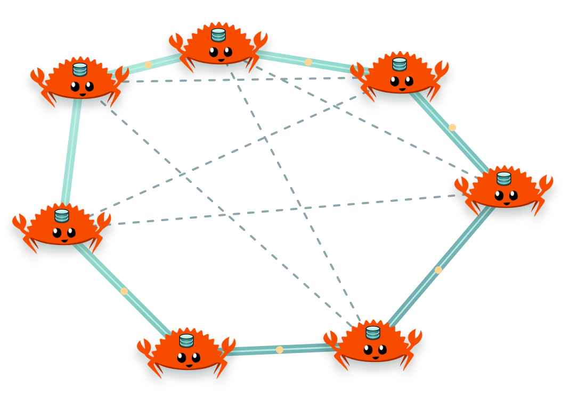

# actordb

<p align="center">
  
</p>

An actor-based distributed key/value database for embedded Rust applications,
with logical tables, a standalone Rust SDK and opt-in persistence.

[CI](https://github.com/slawlor/actordb/actions/workflows/ci.yaml)
· [crates.io](https://crates.io/crates/actordb)
· [docs.rs](https://docs.rs/actordb)
· [coverage](https://codecov.io/gh/slawlor/actordb)

## Why choose ActorDB?

**High-throughput state access inside your Rust service, nearby replicas, and
explicit durability for each write.** ActorDB combines resident KV reads,
supervised actor execution, convergent replication, optional RocksDB persistence
and programmable placement in one Rust integration. Use embedded calls for local
access or the standalone SDK for remote callers.

The strongest fit is a dataset that fits in RAM and represents **latest-known
state**: service/session snapshots, device state, restartable caches and derived
projections. Hybrid logical clocks and last-writer-wins merging give replicas a
deterministic way to converge. Applications that need source-event ordering must
preserve that ordering before submitting updates.

### Performance: over one million embedded point reads per second

The [M4 Max laptop checks](docs/benchmarks/laptop-sizing.md) measured the following
throughput in separate 30-second phases ([raw results](docs/benchmarks/laptop-sizing/sustained-qps.json)):

| Access path / completion boundary | Total operations/s | Average operations/s per fragment |
|---|---:|---:|
| **Embedded point reads** | **1,149,024** | **35,907** |
| **Embedded point reads, RocksDB enabled** | **1,146,396** | **35,825** |
| **Embedded in-memory writes** | **585,382** | **18,293** |
| Loopback gRPC point reads | 55,634 | 1,739 |
| Loopback gRPC writes | 55,127 | 1,723 |
| RocksDB buffered/applied writes | 531,837 | 16,620 |
| RocksDB local `StoreCommitted` writes | 28,168 | 880 |
| RocksDB local `StableCommitted` writes | 25,309 | 791 |

**Performance is a reason to prefer ActorDB for hot, application-owned KV state.**
The embedded path avoids an RPC hop and its serialization work for locally held
keys. Reads use the resident cache, including with RocksDB enabled. Fragment
workers spread work across runtime threads; priority pools and admission limits
let the application control competing work. Regional routing prefers nearby
replicas, reducing exposure to cross-region round trips. Write policies let each
operation request memory application, store completion or a stable fence according
to its durability needs.

Compared with a remote KV service such as Redis/Valkey, the embedded integration
removes the client/server transport from local operations. Compared with using
RocksDB directly, ActorDB adds replication, placement and lifecycle controls while
serving reads from resident state. These are design advantages for the workloads
below; the measurements establish ActorDB's throughput on the tested paths.
Competitive QPS rankings require matched workloads, hardware and completion
boundaries; no such comparison has been measured here.

The checks used a 16-core M4 Max with 64 GiB RAM, four runtime threads, 16 callers,
32 fragments, 20,000 hot keys and 1 KiB values, with no replica fanout. RPC client
and server shared the laptop, using a reused plaintext channel and receive
admission sized for 16 callers. Per-fragment rates are totals divided by 32;
CPU, WAL and storage execution remain shared. Point-operation QPS does not
represent scan/SQL throughput or a production latency guarantee. The placement
planner models examined records and touched fragments for those query workloads.

### Strongest use cases and industry alternatives

| Use case | Prefer ActorDB for | Why this design helps | Relevant alternatives |
|---|---|---|---|
| **High-QPS state inside a Rust service or stateful worker** | Hot KV access where the application can hold the serving fragments locally and wants replication in the same integration. | The embedded path measured 1.15M point reads/s and 585k in-memory writes/s. Fragment supervision, execution pools and shutdown ownership integrate with the service lifecycle. | Plain RocksDB, sled, SQLite; external Redis/Valkey |
| **Restartable caches and materialized projections** | Read-heavy derived state with TTL, peer recovery and persistent local restart. | Resident reads keep RocksDB off the read path; named tables separate data and execution pools. Committed state survives restart, and reconciliation restores peer versions. | Redis/Valkey; PostgreSQL projection tables; application-built KV caches |
| **Latest-known entity, session or device state** | Frequent last-value updates from multiple serving replicas with explicit application outcomes. | Serving replicas accept writes and converge through LWW. Per-key ordering within a priority pool and selectable completion boundaries make execution and durability observable. | Redis/Valkey; Cassandra/ScyllaDB; DynamoDB |
| **Region-local application state with remote copies** | Keeping query traffic near callers while independently pacing replication across regions. | Reads prefer the serving local Node, then same-region replicas. The planner targets regional fragment coverage; WAN batch/round limits pace outgoing replication, and writes can require an outside-region ACK. | Cassandra/ScyllaDB datacenter replication; DynamoDB Global Tables; regional Redis deployments |
| **Foreground requests alongside bulk work** | Services that own traffic priorities, table admission and bounded query/batch execution. | High/Default/Background pools separate scheduling; table-local admission controls incoming work. Batches retain per-key outcomes, and scans/SQL use bounded pages. Cache locks, storage and hardware remain shared. | Redis/Valkey; general database servers; custom actor/cache layers |
| **A custom placement and replacement controller** | Building workload-aware replica placement and maintenance directly into the service's control plane. | Portable planning, observed-load overrides, bounded replica changes, readiness-gated overlap, checkpoints and guarded membership workflows provide reusable building blocks. | Plain RocksDB plus custom distribution code; FoundationDB; CockroachDB |
| **Operational inspection of KV state** | Key/range/prefix queries and exact aggregates over the same named tables serving application traffic. | Projections and pagination inspect data across fragments through the existing Node/SDK. Execution uses bounded background pages. | Plain KV scans; SQLite/PostgreSQL; DuckDB |

**ActorDB's advantage is the combination of throughput, locality and control.**
Teams building a stateful Rust service can integrate data access, replica topology,
durability policy and maintenance as programmable parts of that service. The
current pre-1.0 design uses eventual LWW consistency, keeps the live dataset in
RAM and treats regional coverage as a soft goal. Its SQL surface covers bounded
KV queries and aggregates; reads can observe older replica versions.

### What persistent RocksDB adds

| Capability | What you get with RocksDB | Completion boundary |
|---|---|---|
| **Committed state survives a Node restart** | Retained winners, TTL deadlines and tombstones reload from local storage; durable clock floors prevent restarted writers from reusing older versions. | Only persisted state is recoverable from that disk. Ordinary cached puts can return while persistence is still buffered. |
| **Synchronous WAL commits by default** | Flushed batches use `SyncWal`; `AsyncWal` is an explicit alternative for workloads accepting a weaker ordinary backend boundary. | `StoreCommitted` waits for actor buffers to flush and the backend to accept the batch. `StableCommitted` additionally waits for the backend's explicit stable fence. |
| **Durable replica acknowledgements** | Write concerns can require actual store/stable evidence from eligible replicas, including a separately requested outside-region ACK. | Numeric/majority ACKs and storage durability are independent policies. Completion evidence reports the achieved boundary; replica convergence remains eventual LWW. |
| **Stable, resumable checkpoints** | Native immutable snapshots back bounded export; integrity-checked chunks and atomic record/import-cursor batches support retryable import while preserving versions and namespaces. | Incomplete import blocks ordinary access until the exact retry completes. Checkpoints need a trusted source; integrity digests are not signatures or writer authority. |
| **Safer replacement and retention workflows** | Store identity/layout validation, stable target floors and guarded handoff help a controller sequence replacement and retire durable prefixes. | Controllers own live readiness evidence, overlap capacity and application writer authority. Disk alone does not certify that every replica has the newest value. |

RocksDB **adds durable backing while preserving the resident read path**. Size
RAM for the live dataset and disk for persistent records, WAL and compaction
headroom. For authoritative mutations, request the required durability/write
concern explicitly. These policies certify write completion within ActorDB's
per-key, eventually consistent model. See [persistence](docs/persistence.md),
[write evidence](docs/write-concerns.md) and [checkpoints](docs/stable-checkpoints.md).

### Tooling that makes the design practical

| Tool or feature | Why you would use it |
|---|---|
| **`actordb-plan` and portable placement library** | Turn expected records, key/value sizes, regions, QPS and query work into a proposed fragmap and per-host resource/traffic estimates. Evaluate an existing map, expose coverage gaps and load observed fragment costs. Export JSON reports or compatible TOML. |
| **Sizing and calibration probes** | Measure record/index memory, fragment/table overhead, embedded/RPC CPU, WAL fences, visibility lag and restart recovery. Load hardware-specific templates with `--profile`; generic defaults and laptop measurements are estimates, not universal host limits. |
| **Placement and membership APIs** | Publish static maps or integrate your controller, add overlap before removing replicas, and use verified readiness and stable handoff evidence for planned changes. |
| **Drain and shutdown APIs** | Close admission and retain accepted application, response and storage work through timeout/cancellation. Choose a local stable boundary and, separately, per-target replication drain evidence. |
| **Typed status and bounded metrics** | Inspect lifecycle, readiness/blockers, node/table/fragment/peer/pool/worker activity and actual WAN permit usage. Freshness and omitted observations remain explicit. |
| **Standalone SDK and replaceable RPC/peer transports** | Use reusable gRPC channels or implement `RpcClient`/`RpcService` for a framework such as Thrift. Supply TLS, credentials and ACLs through the selected adapters; the SDK does not join peer membership. |
| **Docker and release verification** | Exercise partitions, SIGKILL/restart, cluster growth/shrink and SDK scenarios. CI checks the feature matrix, Rust minimum version and dependency-ordered package publication. |

## Current release and deployment

ActorDB `0.11.2` requires Rust **1.88+**. Deploy matching database, protocol,
query and SDK crates together. Peers retain exact protocol **6** and RocksDB
record/manifest format **3**. Application APIs migrate together to typed unary
`actordb.rpc.v1` RPC: there is no old application listener, handshake or fallback.
Current-format storage does not need conversion for this RPC change;
non-current formats still require a fresh deployment. The SDK defaults to
64 MiB per response and 256 MiB aggregate materialization reservations;
configure both allowances explicitly for larger trusted workloads.

```toml
[dependencies]
actordb = "0.11.2"
```

The default feature set enables `grpc`, but includes no storage backend. The Node uses a volatile actor cache and
provides the `KvStore` interface without enabling a bundled store. RocksDB is
an independent opt-in:

```toml
actordb = { version = "0.11.2", features = ["rocksdb"] }
```

The `memory` feature exposes a no-op test store, not durable storage.
The `tls` feature provides a rustls transport configured with caller-provided
certificates and trust policy. Custom transports are supported independently.
Protocol bindings are committed Rust; normal builds require no protobuf
compiler. RocksDB builds additionally need its native dependencies and libclang.

This is pre-1.0 software. See [fresh deployment](docs/support-api-migration.md),
[release notes](CHANGELOG.md) and [publication procedure](docs/releases.md).

## Embedded usage

```rust
use actordb::node::{DrainOptions, Node, NodeConfig};

let node = Node::start(
    "node-a".to_string(),
    "127.0.0.1:0".parse()?,
    NodeConfig::builder().fragment_count(1).build(),
).await?;

let users = node.table("users")?;
users.put("alice", b"hello".to_vec()).await?;
let value = users.get("alice").await?;
assert_eq!(value.unwrap().value, b"hello");

// Admission closes synchronously; accepted work and responses remain owned.
node.begin_drain();
node.drain_requests(DrainOptions::default()).await?;
node.finish_shutdown(DrainOptions::default()).await?;
```

The default table is `KV`; named table handles share the same Node, listener and
peer connections while isolating keys, queries, caches and durable namespaces.
Equal user keys hash to the same fragment across tables.

Point operations support puts, reads, deletes, TTL and priority. Batch APIs
preserve input positions and per-key outcomes; they are not transactions.
SQL names its relation explicitly and supports bounded filters, projections,
pagination and exact aggregates over logical tables.

## What the database provides

- **Actor execution:** each fragment has a supervised dispatcher, table-local
  High/Default/Background worker pools, a TTL cleaner and a periodic snapshotter.
  Sticky worker routing preserves per-key ordering within a priority pool;
  shared-state LWW merging orders competing work across pools.
- **Placement and replication:** static replica maps and caller-controlled
  dynamic placement, bounded forwarding, tracked batch ACKs, and streamed
  session/round-correlated anti-entropy. Late joiners and restarted nodes recover
  through reconciliation.
- **Versioned records:** ordering by
  `(timestamp_ms, logical_counter, node_id, is_tombstone)`. Deletes and expiry
  markers are retained tombstones; reads hide them, while replication and
  checkpoints preserve them.
- **Durable boundaries:** configured or explicit stable local fences,
  cancellation-safe application drain, receive/apply shutdown and separate
  per-target replication-drain evidence.
- **Write concerns:** local/count/majority and region requirements, strict cap
  enforcement, actual memory/store/stable evidence, frozen replica identities
  and operation/version-floor receipts.
- **Observations:** owned startup, typed lifecycle/readiness/blockers, actual
  replication progress and bounded backend-neutral node/table/fragment/peer/
  pool/worker metrics with optional timing and explicit freshness/omissions.
- **Recovery and membership:** stable bounded checkpoints, authenticated chunks,
  resumable atomic import cursors, stable target-floor certificates and guarded
  joint/final placement workflows.

## Transport and identity

Plain TCP is useful for local testing. Real deployments should supply mutually
authenticated TLS through `Network` or the optional `TlsNetwork`. ActorDB does
not provision certificates or choose the host's trust policy.

`NodeConfig::cluster_secret` optionally supplies at least 32 high-entropy random
bytes. Both peers prove fresh possession through a challenge-bound HMAC.
There is no capability or version-range negotiation: a non-current peer is
rejected. The shared secret proves possession, not which member is speaking,
and does not encrypt or authenticate subsequent frame contents. TLS supplies
those properties.

Receiver generation allowlists and hot fences close old sessions and retain
already-accepted actor, response and store work until completion. They are
operational controls, not proof of credential revocation. A process retaining
valid TLS/shared-secret credentials can claim an allowed generation; excluding
it requires external credential revocation and application writer authority.
There are no Ed25519 process keys or signed-frame headers.

## Rust application SDK

The peer listener is not an application endpoint. The default gRPC adapter
wraps an `Arc<Node>` through `grpc::GrpcServer`; SDK calls use unary
`actordb.rpc.v1.ActorDb/Call` and never join peer membership.

```toml
actordb-client = "0.11.2"
```

The SDK supports point/batch operations, TTL, priorities, write concerns,
table views, scans/SQL and local inspection. Calls run concurrently within
request and aggregate response-memory budgets; there is no custom client
handshake, connection identity or request-ID state.

gRPC is default-enabled in both crates. Vendors disable default features and
implement `RpcClient`/`RpcService` using another framework, such as Thrift.
`NodeRpcService` and the generic SDK do not authenticate clients. TLS,
credentials and ACLs belong to the chosen RPC adapter. The gRPC implementation
accepts provisioned tonic TLS configuration and framework-native authorization
metadata/hooks. HTTP/2 channels are reusable; RPC does not mean dialing per call.

Closing the SDK never shuts down the database. Accepted mutations remain
owned through apply/fan-out; an uncertain reply is never transparently replayed.
See [RPC/transports](docs/transports.md) and [client options](docs/client-options.md).

## Persistence and checkpoints

Without a store, a Node restart loses its local cache. Use
`NodeConfig::with_rocksdb` or `with_rocksdb_options` for offered persistence,
or provide an explicit custom `KvStore`. RocksDB defaults to synchronous WAL
writes, validates its current identity/layout, and rejects non-current stores
without adoption or repair.

Request drain defaults to the configured local persistence contract.
`DrainDurability::Applied` waits for execution/response ownership only;
`StableCommitted` requests an explicit stable backend fence. Timeout or
cancellation leaves work owned and admission closed for retry.

Completed shutdown releases the Node's store attachment. Keep a caller-owned
backend `Arc` when exporting a checkpoint after shutdown; an expired weak
handle returns `BackendReleased`. Export uses a stable bounded snapshot.
Import verifies chunks before applying them and commits records/cursor
atomically. An incomplete import blocks ordinary access until exact retry
completes.

Checkpoint format is `ACTCP003`; staged membership journals use `ACTMEM04`.
Native certificates check actual receiver fence/drain reports and retained
stable target floors. Neither these certificates nor a Serving snapshot
establishes application writer authority.

## Public crate boundaries

- `actordb::node`: Node/table operations, runtime configuration, drain, status
  and metrics.
- `actordb::actor`: dispatcher/supervisor/maintenance APIs and shared fragment
  state. Managed worker pools remain internal.
- `actordb::replication`: bounded standalone sender construction and replication
  reports; no unbounded compatibility entry point.
- `actordb::store`, `checkpoint`, `membership`, `placement`, `network`,
  `query`, `write_concern` and `ttl_expiry`: their respective support contracts.
- `actordb-protocol`: public `actordb_protocol::meta` and application wire
  schemas, current protocol constants and portable write-evidence types.
- `actordb-query`: portable SQL/query planning without database/native
  dependencies.
- `actordb-client`: standalone application SDK.

There is no public `actordb::proto` or `actordb::supervision` compatibility
module. `NodeStatus.lifecycle` is the typed lifecycle, `drain` is the separate
ownership snapshot and `shutdown_stage` is always present. Unimplemented
percentage/lag fields and no-op tombstone collection are absent.

## Documentation

- [Architecture](docs/architecture.md) and [API](docs/api.md)
- [Configuration](docs/configuration.md), [routing/placement](docs/routing-placement.md)
  and [operations](docs/operations.md)
- [Regional placement and workload sizing](docs/placement-planning.md),
  [portable planner/CLI](actordb-placement/README.md)
- [Replication](docs/replication.md), [consistency](docs/consistency.md)
  and [tombstones](docs/tombstones.md)
- [Regional replication concurrency](docs/regional-replication.md)
- [Persistence](docs/persistence.md), [checkpoints](docs/stable-checkpoints.md)
  and [staged membership](docs/staged-membership.md)
- [Draining](docs/draining.md), [status](docs/status.md), [metrics](docs/metrics.md)
  and [detailed observations](docs/observability.md)
- [Generation authority](docs/peer-authority.md) and
  [replacement safety](docs/replacement-safety.md)
- [Write concern](docs/write-concern.md), [regions](docs/write-concern-regions.md),
  [overrides](docs/write-concern-overrides.md) and [durability evidence](docs/write-concerns.md)
- [Batching](docs/batching.md), [scanning](docs/scanning.md) and [SQL](docs/query.md)
- [Rust SDK](actordb-client/README.md), [client options](docs/client-options.md)
  and [TLS/custom transports](docs/transports.md)
- [TTL callbacks](docs/ttl-expiry-callbacks.md), [testing](docs/testing.md)
  and [releases](docs/releases.md)

## Validation and examples

```bash
cargo test --workspace --exclude docker-tests
cargo test --workspace --exclude docker-tests --features actordb/memory
cargo test --workspace --all-features
cargo clippy --workspace --all-features --all-targets -- -D clippy::all -D warnings
```

Examples include `three_node_demo`, `lifecycle_observations`, `peer_fence`,
`write_concern_evidence`, `checkpoint_restore` and `staged_membership`.
Native checkpoint/membership examples require `--features rocksdb` and fresh
directories. The SDK's `tls_demo` runs a caller-configured mTLS mesh and
application listener.

Docker scenarios exercise three-node replication, SIGKILL/restart
reconvergence and a separate SDK-only client across sharded nodes and ingress
restart. See [testing](docs/testing.md) for commands and CI coverage.

## Limits

ActorDB is not consensus or a transaction system. It does not elect writers,
allocate hosts, prove host death, or infer global equality from a queue/ACK.
Worker crashes can abandon accepted mailbox jobs; orderly shutdown drains them.
Backpressure is explicit, but actor queues and wire budgets are not a
process-wide heap bound. Unknown outcomes remain unknown.

## Contributing and license

See [CONTRIBUTING.md](CONTRIBUTING.md). Licensed under [MIT](LICENSE).
