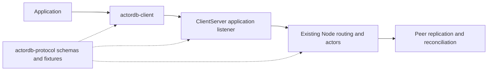

# Rust client and query companion design

Status: implementation design, initially reviewed against `main` at `0e6f0c9`
(ActorDB 0.3.0). Current usage is documented in [SQL queries](query.md) and the
[Rust SDK guide](../actordb-client/README.md).
This document consolidates independent protocol, Rust SDK, and query reviews.
The architecture is implemented in the companion crates; streaming or multiplexed SDK requests, topology
discovery, prepared mutation replay, and remote operator controls remain future
work. The findings below describe the original baseline.

## Current implementation and protocol coverage

ActorDB provides an embedded Rust `Node` API and protobuf peer traffic over
four-byte big-endian length-prefixed streams. Plain TCP is implemented;
`Network` permits custom transports. HTTP, gRPC, Redis, and WebSocket APIs
are not present. The peer body limit is 16 MiB; its current protocol version
is 3, requiring seven capability bits.

The complete catalog needs explicit mappings rather than treating every
peer message as an application request:

| Offering | Current implementation | Companion coverage |
| --- | --- | --- |
| Point writes | `put`, `put_with_priority`; `ForwardedPut` / `MutationResponse` | Typed put with write options and exact errors. |
| TTL and deletion | `put_with_ttl`, `delete`; expiry/tombstone fields on forwarded mutations | TTL writes and deletes; retain original expiry through any replay. |
| Point reads | `get`, `get_with_priority`; `ForwardedGet` / `GetResponse` | Optional value with version/expiry metadata; distinguish missing, shed, and unavailable. |
| Batch writes | `put_multi`, priority variant; `BatchPut` / `MutationResponse` | Per-position outcomes, preserving order, duplicates, and partial failures. |
| Batch reads | `get_multi`, priority variant; `BatchGet` / `BatchGetResponse` | Ordered results; consume bounded prefixes and request omitted suffixes. |
| Distributed scans | `Node::scan`; fragment-specific `ScanRequest` / `ScanResponse` | Server coordination, legacy semantics clearly labeled, new paged API for complete traversals. |
| Query / map-reduce | Filter, project, collect only | Typed query plan, exact reducers, SQL facade. |
| Connection and authentication | `Hello` / `HelloAuth`, shared-secret challenge proof | Separate application handshake, credentials, versions, capabilities, and advertised limits. |
| Replication | `SessionStart`, `ReplicateBatch`, `BatchAck`, `BatchNack` | Preserve schema and conformance coverage for peers and tooling. |
| Anti-entropy | `ReconcileRequest`, `ReconcileResponse`, `ReconcileFetch`, `ReconcileData` | Preserve schema and conformance coverage for peers and tooling. |
| Inspection | Node identity/address, peer count, health, placement report | Typed inspection RPCs with documented local/cluster scope. |
| Debug inspection | `get_all`, `sender_report`, `sync_entries_applied` | Explicit debug/admin mappings; local dumps must remain distinguishable from distributed scans. |
| Lifecycle and placement | Start/configure locally; `connect`, shutdown, replication drain; controller updates | Hosting stays local. Remote control uses a separately authorized admin API; placement updates require a controller adapter. |
| Retired frames | `SyncRequest`, `SyncResponse`, former envelope field 2 | Preserve compatibility definitions/reserved identifiers; reject retired traffic. |

Sources: [peer schema](../actordb-protocol/proto/meta.proto),
[Node APIs](../actordb/src/node.rs), [transport](../actordb/src/network.rs),
[consistency](consistency.md), and [batching](batching.md).

## Findings that determine the design

### The existing listener is a peer endpoint

Authentication inserts the identity into the peer registry, notifies
membership, and, in default full-replication mode, creates replication
senders and initiates reconciliation (`node.rs:7793`). An SDK impersonating
a node would enter replication machinery. Forwarded writes also assume
trusted, already-stamped operations with timestamps, origin IDs, and boot
metadata. Application clients should submit intent; the server should own
clock, expiry, and routing decisions.

### Scan support is not negotiated

Commit `6beb911` added envelope fields 21/22 without changing peer v3 or its
required capabilities. Older v3 peers complete the handshake, then reject
scan envelopes during preflight. Add optional scan capabilities, retain
negotiated capabilities per physical connection, and check them before
sending. Paged scans and query plans need their own capabilities. If no
reachable holder supports an operation, return an explicit unsupported
feature error. A coordinated version bump is the alternative if a rolling
upgrade is deliberately unsupported.

### SQL and reduction are unfinished

Current matchers are `All` and `Prefix`; transforms are `Identity`,
`KeyOnly`, and `PrefixBytes`. No SQL parser, planner, or reducer exists.
[The scan guide](scanning.md) calls the implementation map-only.

Existing scan results cannot establish exact aggregates:

- Limit and offset apply to every fragment separately; merged order is
  fragment ID followed by local key order.
- Limit zero substitutes 10,000 per fragment. The coordinator silently
  discards rows beyond 100,000, without completion metadata.
- `join_all` retains fragment vectors before the coordinator cap applies.
  Counts do not bound value bytes; oversized responses can become timeouts.
- Scans hold a read lock through a synchronous pass. Background admission
  does not remove write contention from that shared lock.
- Inbound scans spawn tasks per request without a separate query-task
  budget or connection-owned cancellation.

Sources: `actor/scan.rs:43`, `actor/fragment_state.rs:355`,
`node/scan.rs:144`, `node/scan.rs:400`, and `node.rs:9284`.

## Recommended architecture



- **`actordb-protocol`**: canonical peer and application protobuf schemas,
  generated Rust messages, neutral value/query contracts, pure validation,
  and language-independent fixtures. Preserve `actordb::proto` reexports.
- **`actordb-client`**: Tokio stream SDK with a TCP convenience API, bounded serialized requests,
  operation methods, and structured errors. No normal
  dependency on ActorDB actors, RocksDB, or native protobuf compilation.
- **`actordb::client_server::ClientServer`**: opt-in listener composed around
  an existing `Arc<Node>`, with its own authentication, admission, response
  paging, and task ownership. Client connections never enter the peer map.
- **Server query modules**: authoritative parser, validation, planning,
  fragment execution, and reduction. Both SQL text and structured plans
  resolve to the same validated plan. The portable `actordb-query` crate shares parsing, plans, and reduction
  contracts with the SDK.

A role on the peer port would reuse one listener but require changes to its
handshake, membership, election, dispatch, and replication paths. Prefer the
separate listener. Additional language SDKs consume the application schema;
HTTP/gRPC gateways can be added if needed later.

Check generated Rust protocol code into the protocol package and verify
regeneration in CI, so ordinary SDK builds do not compile `protobuf-src`.
Keep Rust 1.88 support and compatible registry versions plus local path
dependencies. Extend package verification and publication in dependency
order; the updated release workflow stages and publishes all four libraries together.

## Rust SDK and application contract

Use a cheap-to-clone `Client` sharing a serialized TCP connection:

```rust,ignore
use actordb_client::{Client, ClientOptions};
let options = ClientOptions::builder()
    .timeout(Duration::from_secs(5))
    .max_queued_requests(256)
    .build();
let client = Client::connect("127.0.0.1:7449".parse()?, options).await?;
client.put("user:42", b"ada".to_vec()).await?;
let value = client.get("user:42").await?;
client.close().await;
```

Start with a configured application endpoint and server routing. Each SDK
operation maps to the catalog above; SDK options provide all three existing
priorities. Node adapters combine TTL, deletion, and priority through
admitted operation methods. `Client::inspect` provides read-only inspection; operator controls
require a future separately authorized API. Closing an SDK connection only
closes that client's resources.

Application v1 negotiates versions and optional features independently of
peer v3. Limits are fixed protocol contracts; topology discovery and explicit
cluster identity negotiation remain future work. Client authentication is
separate from the peer cluster secret. The SDK supports caller-supplied streams
through `Client::from_stream`; the listener accepts a custom `Network` or existing
`Acceptor`. See the [transport guide](transports.md) and its caller-configured TLS
example. Challenge authentication and transport confidentiality have distinct contracts.

The first SDK serializes requests per connection and validates response kinds,
IDs, keys, cardinality, and statuses. Future multiplexing needs independent
reader/writer ownership and connection-generation correlation. Bound in-flight
requests, retained payload bytes, outbound frames/bytes, receive allocation,
decoded collection counts, and future streamed consumer buffers. One absolute request deadline covers admission through
response; handshake and incomplete-frame I/O also have deadlines. Cancellation
releases unsent work and pending registrations; it cannot undo an applied
mutation. Listener sessions are joined on shutdown; client close releases its
stream.

Keys remain UTF-8 strings and values remain bytes. Protocol integer fields
must remain lossless in every SDK, including JavaScript BigInt/string adapters.
Errors need stable codes for invalid input, unsupported features, auth,
transport, timeout, backpressure, unavailable, storage, superseded, expired,
protocol violation, shutdown, and ambiguous mutation outcome. Bound diagnostic
text; never convert unavailable into missing.

### Mutation retry contract

Current retries are idempotent because they reuse the exact LWW version,
payload, tombstone, and absolute expiry. Sequence/boot IDs are not a dedup
ledger. Calling `Node::put` again generates a fresh version and may overwrite
an intervening write; repeating a TTL write can extend its lifetime.

For v1, retry reads within the request budget. Retry writes only before
possible dispatch; after possible application with a lost reply, return
`UnknownOutcome { operation_id }`. A transport correlation ID cannot make a
new write safe. Transparent replay requires a server-prepared portable stamped
mutation ticket or durable replicated deduplication. Prefer the prepared
ticket approach when adding that feature: clients receive the exact validated
operation before applying it, and replay preserves its identity and expiry.
Tickets require explicit principal/cluster/payload binding and validation;
an in-memory gateway cache is insufficient after process loss.

Mutation success continues to mean serving-owner application, not a quorum,
replication fence, or fsync. Admin replication drain retains its existing
narrow guarantee and typed results.

## Completing SQL-like map-reduce

Introduce a distinct paged scan/query API while retaining legacy `Node::scan`
semantics. SQL is a bounded facade over serializable plans, not shipped code.

```sql
SELECT key, PREFIX_BYTES(value, 32)
FROM kv WHERE STARTS_WITH(key, ?)
ORDER BY key ASC LIMIT 100 OFFSET 20;

SELECT COUNT(*), SUM(OCTET_LENGTH(value))
FROM kv WHERE STARTS_WITH(key, ?);

SELECT SUM(CAST(value AS BIGINT))
FROM kv WHERE STARTS_WITH(key, ?);
```

The initial relation is `kv(key TEXT, value BYTES, frag INT)` plus explicit
durable-envelope metadata (`timestamp_ms`, `logical_counter`, `node_id`,
`expires_at_ms`, and `is_tombstone`). Support key equality, prefix matching,
metadata predicates, key/value/prefix/length/metadata projections, and
COUNT/SUM/MIN/MAX over supported explicit expressions. Bind parameters as typed
data. Numeric casts use strict decimal signed-64 parsing; invalid bytes produce
typed errors. Use checked wide partial sums and a lossless integer result
encoding. COUNT of an empty set is zero; SUM/MIN/MAX are null. Retained
tombstones require the explicit `INCLUDING TOMBSTONES` modifier. Reject mixed
aggregate and row projections without grouping. Defer joins, grouping,
implicit JSON schemas, arbitrary functions, and unrestricted ordering
expressions.

Row queries default to global key ascending order. Apply OFFSET/LIMIT once
after filtering and global merge. SQL LIMIT zero means zero rows. Aggregate
queries process their complete qualifying input; row pagination clauses are
rejected on aggregate plans in v1 to avoid ambiguous truncation semantics.
Cap query text, parser depth, parameters, offsets, page bytes, active work,
and deadlines. Budget exhaustion is an explicit failure.

### Execution and completeness

Build on the ordered-key index and existing revision/pinned-time summary
pages (`actor/fragment_state.rs:430`):

1. Produce pages bounded by exact encoded bytes, matches, and examined-key
   work. Release the fragment lock between chunks. Advance using the last
   examined key even when a page contains no matches; preserve empty keys
   with an optional exclusive cursor. Reject individually oversized rows.
2. Bind continuation to plan, fragment, holder/incarnation, placement epoch,
   local revision, direction, and pinned TTL time. Replica-local revisions
   cannot validate continuation on another holder. Mutation/restart/movement
   requires bounded restart or explicit failure, not mixed fragment pages.
3. Fan out with bounded concurrency and a coordinator-wide byte budget.
   Merge row streams in global key order using bounded fragment heads, then
   apply global pagination. Memory limits must include buffered heads even
   when few requests are active.
4. Run reducers at holders over complete bounded ranges. Merge each accepted
   partial state exactly once and finalize only after every required fragment
   completes. COUNT/SUM must never reduce legacy capped scan samples.
5. Mark terminal query success explicitly. Streamed pages before that marker
   are provisional; a failed query cannot be presented as a complete result.

Select one holder per fragment to avoid counting replicas twice. Before a
fragment contributes accepted data, failover may choose another holder; after
that point it must restart or fail explicitly. Local revision checks can yield
`QueryChanged` under sustained writes. These are complete per-fragment views,
with no global snapshot or stronger consistency than the database provides.

## Implementation sequence and acceptance gates

| Stage | Deliverable | Required verification |
| --- | --- | --- |
| 1. Protocol foundation | Shared package, preserved public reexports, application v1 schema, peer scan capability gating | Existing frame/auth fixtures unchanged; old/new peer scan behavior explicit; standalone package builds without native dependencies. |
| 2. Application listener and Rust SDK | Point/batch/TTL/delete/priority operations, metadata/errors, inspection and explicit admin mappings | Real SDK-to-Node tests; opening/closing clients leaves peer count and senders unchanged; duplicate batch positions preserved. |
| 3. Bounded query traversal | Byte/work-bounded pages, continuation, cancellation, owned tasks | Large values, sparse pages, empty/Unicode keys, saturation, stalled consumers, mutation/restart/failover, TTL, and bounded memory. |
| 4. Query engine and SQL | Global pagination, exact reducers, parameterized SQL and typed plans | More than 10,000 rows per fragment and 100,000 globally; interleaved fragment keys; LIMIT zero; aggregate completeness and retry deduplication; numeric errors/overflow. |
| 5. SDK parity and release | SDK query/scan/admin coverage, examples, language-neutral conformance suite, package workflow | Every active catalog entry mapped or documented as peer/hosting-only; server feature matrix, Rust 1.88, package dry-runs, lossless interoperability fixtures. |

Stages 2 and 3 can proceed in parallel after stage 1 defines their contracts.
Future agents should own separate crate/module boundaries and coordinate
schema changes centrally. Transparent mutation replay requires its own
lost-response/intervening-write/unchanged-expiry tests before automatic write
failover is enabled.

Retain backend-free, memory-only, and all-feature workspace checks; add
standalone client dependency/package checks. The overall offering is complete
when SDK operation parity and exact SQL execution both pass these gates.

## Remaining product decisions

Before publishing a stable application protocol, settle the default client
credential/TLS packaging, breadth of remote admin controls, prepared mutation
ticket lifecycle, and continuation behavior under sustained mutation. The
recommended initial defaults are separate client credentials, explicit admin
capabilities, ambiguous-outcome errors without automatic write replay, and
bounded restart with an explicit query-change error.
